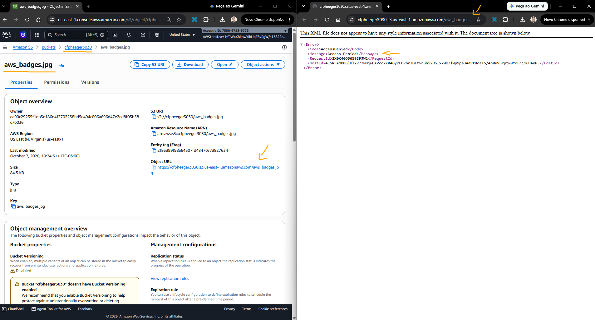
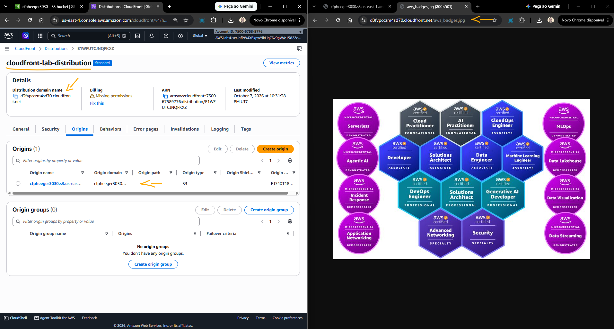
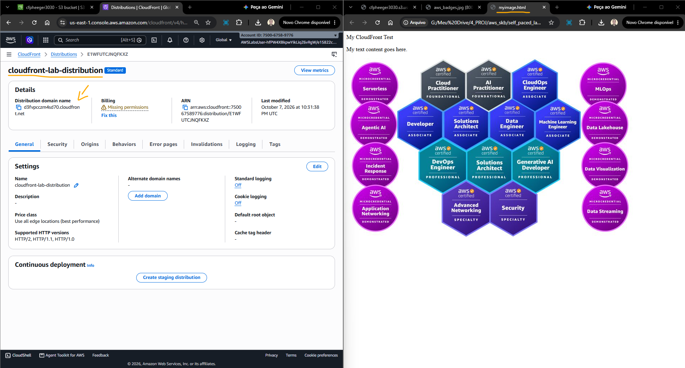

# Lab - Introduction to Amazon CloudFront   

### AWS Skill Builder <a href="../../">aws_skill_builder   </a>
### Training Category: <a href="../../self_paced_lab">self_paced_lab</a>
### Software/Subject: aws   
### Course: <a href="./">spl_058 (Lab - Introduction to Amazon CloudFront)   </a>

#### <a href="https://github.com/PedroHeeger/my_tech_journey/blob/main/credentials/certificates/online_courses/cloud/aws/skb/spl/261007_spl_058_en.pdf">Certificate</a>

---

### Theme:
- Cloud Computing

### Used Tools:
- Operating System (OS): 
  - Windows 11   
- Cloud:
  - Amazon Web Services (AWS)   
- Cloud Services:
  - Amazon CloudFront   
  - Amazon Simple Storage Service (S3)   
  - Google Drive   
- Language:
  - HTML   
  - Markdown   
- Integrated Development Environment (IDE) and Text Editor:
  - Visual Studio Code (VS Code)   
- Versioning: 
  - Git   
- Repository:
  - GitHub   

---

<a name="item0"><h3>Course Strcuture:</h3></a>
1. <a href="#item01">Tarefa 1: Criar um bucket S3 e armazenar um arquivo de imagem</a> 
2. <a href="#item02">Tarefa 2: Criando uma distribuição web do CloudFront</a> 
3. <a href="#item03">Tarefa 3: Testando a distribuição</a> 

---

### Objective:
O objetivo deste laboratório foi compreender o funcionamento do **Amazon CloudFront** e sua integração com o **Amazon S3**, criando uma distribuição do CloudFront para disponibilizar uma imagem armazenada em um bucket do S3 por meio de uma rede de distribuição de conteúdo (CDN).

### Structure:
- [README.md](./README.md): Este documento de README, escrito em **Markdown**, com o conteúdo do laboratório.
- [resource](./resource): Pasta com todos os recursos utilizados neste laboratório.
- [0-aux](./0-aux/): Pasta auxiliar com imagens utilizadas na construção dos arquivos de README desse laboratório.

### Development:
<a name="item01"><h4>Tarefa 1: Criar um bucket S3 e armazenar um arquivo de imagem</h4></a>[Back to summary](#item0)

Na primeira tarefa, o objetivo foi criar um bucket do Amazon S3 contendo uma imagem que seria utilizada como origem da distribuição do Amazon CloudFront. O bucket foi configurado da seguinte forma:
- Region: `us-east-1` (Norte Virgínia) ou `us-west-2` (Oregon)
- Bucket Name: `cfpheeger3030`. O nome foi composto pelo prefixo cf, pela inicial do primeiro nome e pelo sobrenome, seguidos de quatro números aleatórios.
- Object Ownership: `ACLs disabled (recommended)`.
- Block Public Access settings:
    - Block all public access: `enabled`. Quando ativada, essa opção mantém habilitadas as demais configurações de bloqueio, impedindo o acesso público ao bucket e aos seus objetos.

Após o provisionamento do bucket, a imagem [aws_badges](./resource/aws_badges.jpg) foi selecionada e carregada, criando um objeto no bucket. Em seguida, a URL do objeto foi acessada pelo navegador para verificar se ele estava publicamente disponível. Como esperado, o acesso foi negado devido às configurações de bloqueio de acesso público.

A imagem 01 exibe o bucket provisionado, contendo o objeto criado e com o acesso público bloqueado.

<figure>
     
    <figcaption>Imagem 01.</figcaption>
</figure>
 

<a name="item02"><h4>Tarefa 2: Criando uma distribuição web do CloudFront</h4></a>[Back to summary](#item0)

O Amazon CloudFront oferece duas formas de autenticar as solicitações realizadas para uma origem do Amazon S3: o Origin Access Control (OAC) e o Origin Access Identity (OAI). O OAC é o método recomendado pela AWS e permite que o CloudFront acesse objetos privados no S3 utilizando credenciais temporárias e solicitações assinadas. Já o OAI é um mecanismo mais antigo, utilizado para permitir que uma distribuição do CloudFront acesse objetos privados do S3.

O OAI possui funcionalidade semelhante ao OAC, mas apresenta algumas limitações. Por isso, a AWS recomenda o uso do OAC para novas configurações. Entre os cenários não suportados pelo OAI estão:
- Buckets do Amazon S3 em todas as regiões da AWS, incluindo regiões de ativação opcional.
- Objetos protegidos por SSE-KMS utilizando o AWS Key Management Service (AWS KMS).
- Solicitações dinâmicas (PUT, POST ou DELETE) para o Amazon S3.
- Novas regiões da AWS lançadas após dezembro de 2022.

Dessa forma, nesta segunda tarefa foi criada uma distribuição do Amazon CloudFront utilizando Origin Access Control (OAC), configurada da seguinte forma:
- Plan: `Pay as you go`.
- Distribution Name: `cloudfront-lab-distribution`.
- Specify origin:
    - Origin type: `Amazon S3`.
    - S3 origin: `Browse S3`, selecionando o bucket criado na tarefa anterior (`cfpheeger3030`).
- Enable security:
    - Web Application Firewall (WAF): `Do not enable security protections`.

Durante o provisionamento, caso fosse exibida uma mensagem de alerta solicitando a configuração de uma proteção de segurança, foi selecionada a opção `Do not activate security protections`. O processo de criação da distribuição pode levar alguns minutos até ser concluído.

A imagem 02 evidencia a distribuição do CloudFront criada com sucesso, utilizando como origem o bucket do Amazon S3.

<figure>
     
    <figcaption>Imagem 02.</figcaption>
</figure>
 

<a name="item03"><h4>Tarefa 3: Testando a distribuição</h4></a>[Back to summary](#item0)

Com a distribuição provisionada, o próximo passo foi realizar um teste de acesso ao objeto por meio do CloudFront. Para isso, foi criado o arquivo HTML [myimage.html](./resouce/myimage.html), contendo uma tag de imagem configurada com o nome de domínio da distribuição, seguido pelo nome do objeto armazenado no bucket (`d3fvpcczm4sd70.cloudfront.net/aws_badges.jpg`). O arquivo foi salvo e aberto no navegador para verificar o acesso à imagem por meio da distribuição.

Ao acessar novamente o arquivo, a imagem pôde ser carregada mais rapidamente devido ao mecanismo de cache do CloudFront. Após a primeira solicitação, o objeto pode ser armazenado em um local de borda (edge location), permitindo que solicitações posteriores sejam atendidas a partir desse local, quando aplicável, sem a necessidade de buscar novamente o objeto diretamente na origem.

A imagem 03 apresenta o arquivo HTML aberto no navegador, com a imagem sendo carregada por meio da distribuição do CloudFront.

<figure>
     
    <figcaption>Imagem 03.</figcaption>
</figure>
 
